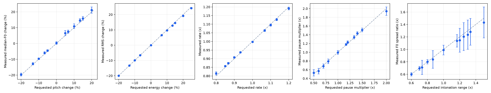
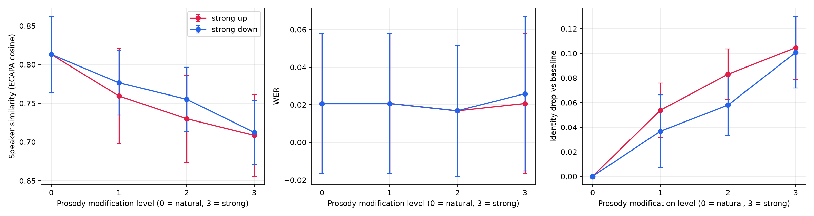

# Controllable Zero-Shot Voice Cloning with Prosodic Manipulation

Clone an unseen speaker's voice from 5–10 seconds of speech, then control **how** that voice
speaks with speech signal processing — pitch, intonation range and contour, tremor, loudness, voice
brightness, speaking rate and pauses, combined into emotion presets — and measure what the change
costs in speaker identity and intelligibility.

> 22AIE450 – Speech Processing · final-year project

## What is original, what is pretrained

| Part | Source |
|---|---|
| Zero-shot voice cloning | **Pretrained** F5-TTS (`F5TTS_v1_Base`), used for inference only |
| Speaker similarity | **Pretrained** SpeechBrain ECAPA-TDNN, evaluation only |
| ASR / WER | **Pretrained** Whisper (`base.en`), evaluation only |
| **DSP prosody controller** (pitch, range, contour slope, tremor, energy, brightness, rate, pauses, emotion presets) | **This project** – [`backend/prosody/`](backend/prosody), method in [`docs/PROSODY.md`](docs/PROSODY.md) |
| **Control-accuracy & identity–prosody evaluation framework** | **This project** – [`backend/evaluation/`](backend/evaluation), [`experiments/`](experiments) |
| API + web studio | **This project** |

No model is trained or fine-tuned from scratch (the specification explicitly scopes this out). The
speaker is defined at inference time only by the reference recording, so every speaker is "unseen".

## Pipeline

```
reference 5-10 s ─► preprocessing ─┐
                                   ├─► F5-TTS (zero-shot) ─► baseline ─► ProsodyController ─► controlled
target text ───────────────────────┘                              │                              │
                                                                  └──────────── evaluation ──────┘
                                      ECAPA speaker similarity · Whisper WER · F0 / energy / rate / pauses
                                      control accuracy (requested vs measured) · identity drop
```

## Prosody controls and presets

All prosody is applied with **signal processing** after synthesis (PSOLA resynthesis, STFT spectral
shaping, gain and pause editing); see [`docs/PROSODY.md`](docs/PROSODY.md) for the algorithm and how each
control is measured.

| Group | Control | Unit | Neutral |
|---|---|---|---|
| Intonation | Pitch | % change of median F0 | 0 |
| | Intonation range | multiplier on F0 variation | 1.0 |
| | Contour slope | semitones/second added per phrase (− falling, + rising) | 0 |
| | Tremor | depth of a 5.5 Hz F0 modulation, semitones | 0 |
| Loudness & voice quality | Energy | % change of speech RMS | 0 |
| | Brightness | spectral tilt (alpha ratio, 1–5 kHz vs <1 kHz), dB | 0 |
| Timing | Speaking rate | multiplier | 1.0 |
| | Pauses | multiplier on internal pause length | 1.0 |

Emotion presets, with directions taken from the vocal-emotion literature (Murray & Arnott 1993;
Burkhardt & Sendlmeier 2000; Scherer 2003). They are starting points, not scientific definitions of emotion:

| Preset | pitch | range | slope | tremor | energy | brightness | rate | pause |
|---|---|---|---|---|---|---|---|---|
| Neutral | 0 | 1.0 | 0 | 0 | 0 | 0 | 1.0 | 1.0 |
| Happy | +15 % | 1.5 | +1.5 | 0 | +20 % | +4 dB | 1.10 | 0.8 |
| Sad | −12 % | 0.6 | −2.5 | 0.2 | −30 % | −6 dB | 0.82 | 1.6 |
| Angry | +8 % | 1.4 | −2.0 | 0 | +40 % | +8 dB | 1.12 | 0.7 |
| Calm | −6 % | 0.75 | −1.0 | 0 | −15 % | −3 dB | 0.90 | 1.3 |
| Excited | +25 % | 1.7 | +2.0 | 0 | +30 % | +5 dB | 1.20 | 0.6 |
| Afraid | +20 % | 1.2 | +0.5 | 0.6 | −10 % | +2 dB | 1.18 | 0.9 |
| **Custom** | every slider free | | | | | | | |

In the UI, choosing a preset fills the sliders; moving any slider switches to **Custom**.

Validate the presets on real clones (accuracy of every control, identity/WER cost and an
independent speech-emotion recogniser's scores):

```powershell
python experiments/run_preset_validation.py --max-sentences 2 --ser --save-audio
```

## Installation (Windows, PowerShell)

Python 3.10–3.12 is recommended for the ML packages.

```powershell
python -m venv .venv                  # or: uv venv .venv --python 3.12
.\.venv\Scripts\Activate.ps1

# NVIDIA GPU (recommended):
python -m pip install torch torchaudio --index-url https://download.pytorch.org/whl/cu128
# CPU only: skip the line above; requirements.txt installs the CPU build.

python -m pip install -r requirements.txt
```

Frontend:

```powershell
cd frontend
npm install
```

Optional configuration: copy `.env.example` to `.env` (device, number of F5 steps, seed, ...).

## Run

Backend (from the **project root**):

```powershell
python -m uvicorn backend.main:app --host 127.0.0.1 --port 8000
```

Frontend:

```powershell
cd frontend
npm run dev          # http://localhost:5173
```

The first synthesis downloads the F5-TTS, ECAPA and Whisper weights (a few GB). To do that up front:

```powershell
python scripts/download_models.py
```

### Web studio

* **Voice cloning + prosody** – upload or record a 5–10 s reference (transcript optional – Whisper
  fills it in), type the text, pick a preset or tune the sliders, press *Generate speech*. You get
  the baseline and controlled audio, speaker similarity, WER, a requested-vs-measured control
  accuracy table, F0 / energy contours, waveforms and mel-spectrograms.
* **Prosody lab** – apply the prosody controller to *any* recording (no TTS needed).

### API

| Endpoint | Purpose |
|---|---|
| `GET /health`, `GET /models` | status, device, which backbone/checkpoint, software versions |
| `GET /presets` | presets and slider limits |
| `POST /synthesize` | reference + text + prosody → baseline & controlled audio + metrics |
| `POST /prosody/apply` | prosody on an uploaded recording (no TTS) |
| `POST /evaluate` | speaker similarity / WER / prosody of any generated clip |
| `POST /analyze` | prosody statistics and contours of one clip |

Interactive docs at `http://localhost:8000/docs`. Errors are clean JSON (`400` bad input, `503`
model unavailable, `500` with a request id) – never a traceback.

### Command line

```powershell
# one zero-shot generation
python experiments/zero_shot/run_zero_shot.py --reference data/references/spk1.wav --text "Hello there."

# prosody variants + measured control accuracy on any recording (no neural models needed)
python experiments/evaluation/run_prosody_experiment.py --input clip.wav --output-dir out --report out/report.json

# evaluate a folder of generated clips
python experiments/evaluation/evaluate_folder.py --reference ref.wav --audio-dir out --target-text "..." --report out/eval.csv
```

### Demo data

```powershell
python scripts/prepare_demo_references.py   # 4 short reference clips (3 voices) bundled with F5-TTS
```

## Research study

`experiments/run_study.py` runs the experiments of the specification for every reference speaker ×
fixed sentence: zero-shot baseline, single controls (pitch ±10/±20 %, energy ±20 %, rate 0.8/1.2×,
pauses 0.5/2×, range), combined control, all presets, the A–E ablation, and the identity–prosody
trade-off sweep (levels 0–3, up and down). It writes `results.csv`, `summary.csv/.md`,
`metadata.json` (model, seed, hardware, software versions) and figures.

```powershell
# data/references/<speaker>.wav + <speaker>.txt (transcript); 5-10 s each, e.g. from VCTK / LibriTTS
python experiments/run_study.py --references-dir data/references --output-dir results/study
```

`--no-tts` uses the reference recording itself as the baseline. That mode only checks the
prosody/evaluation machinery and is flagged as *not zero-shot* in the metadata.

## Verified results

Measured on this machine (Windows 11, RTX 4060 Laptop 8 GB, Python 3.12, torch 2.11+cu128, F5TTS_v1_Base,
NFE 32, seed 42): 4 reference voices x 5 fixed two-sentence passages x 32 conditions = 640 evaluations.
Full tables: [`docs/results/summary.md`](docs/results/summary.md), raw rows: [`docs/results/results.csv`](docs/results/results.csv),
run metadata: [`docs/results/metadata.json`](docs/results/metadata.json).

| | Value |
|---|---|
| Zero-shot baseline speaker similarity (ECAPA cosine, reference vs generated) | 0.813 (per speaker 0.75 - 0.87) |
| Zero-shot baseline WER (Whisper base.en) | 2.1 % |
| Pitch control error (+-10 / +-20 %) | 0.4 - 0.6 percentage points |
| Energy control error (+-20 %) | <= 0.3 percentage points |
| Rate control error (0.8x / 1.2x) | 0.007 - 0.021 |
| Pause control error (0.5x / 2.0x) | 0.04 - 0.06 (measurable in 20/20 items) |
| Identity drop at pitch +-20 % / rate 1.2x / energy +-20 % | 0.09 / 0.056 / ~0 |
| Identity-prosody trade-off, level 0 -> 3 (up) | similarity 0.813 -> 0.709, WER 2.1 % -> 2.1 % |
| Warm GPU latency | ~4-7 s per multi-sentence request (TTS real-time factor ~0.8) |




Reading: prosody can be moved a long way (+-20 % pitch, 0.8-1.2x rate) while intelligibility stays
essentially unchanged; what is paid is speaker identity, roughly 0.05 similarity per modification
level, driven mostly by pitch and rate. Energy and pauses are close to free for identity.
Caveats: only 4 voices (3 distinct recording conditions), one encoder, no human listening test, so
treat the numbers as indicative rather than a benchmark.

## Tests

```powershell
python -m pytest -q
```

Signal tests use a synthetic speech-like signal with known F0 / level / pauses and assert that the
*measured* change matches the *requested* change, that controls do not leak into each other, and
that a DC-offset recording does not break pause handling. API tests use a test-double TTS engine
and fake evaluation models so no checkpoint download is needed.

## Project layout

```
backend/
  api/            FastAPI routes + schemas
  audio/          preprocessing, analysis helpers, visualisation payloads
  core/           TTS engine abstraction, end-to-end pipeline
  prosody/        controller.py (PSOLA pitch/range/rate, pauses, energy) and presets.py   <- novelty
  evaluation/     speaker similarity, ASR/WER, prosody metrics, control accuracy
frontend/         React + Vite + Tailwind studio
experiments/      run_study.py (full study), plot_study.py, single-purpose scripts
docs/PROSODY.md   prosody method
tests/
```

## Limitations

* On Windows, `torchaudio.load` is routed through libsndfile (`backend/utils/audio_io.py`) because
  torchaudio >= 2.9 needs FFmpeg shared libraries for I/O.
* Post-synthesis PSOLA is natural for moderate edits; shifts beyond about ±30 % sound artificial.
* Pause control scales the gaps between sentences (the text is synthesized sentence by sentence
  with a neutral 0.35 s gap); single-sentence text has nothing to stretch and is reported as
  *not measurable*, not as zero error.
* Prosody is utterance-global: no word-level emphasis, no learned emotion model.
* Presets are plausible prosodic starting points, not validated emotion definitions. MOS / SMOS
  human evaluation is not included.
* Speaker similarity uses a single encoder (ECAPA); it is a relative indicator, not a verification
  decision.
* F5-TTS weights are CC-BY-NC.

## Ethics

Only use recordings of speakers who have consented. Generated speech is synthetic and must not be
used for impersonation or deception. The UI and every API response carry this notice.
